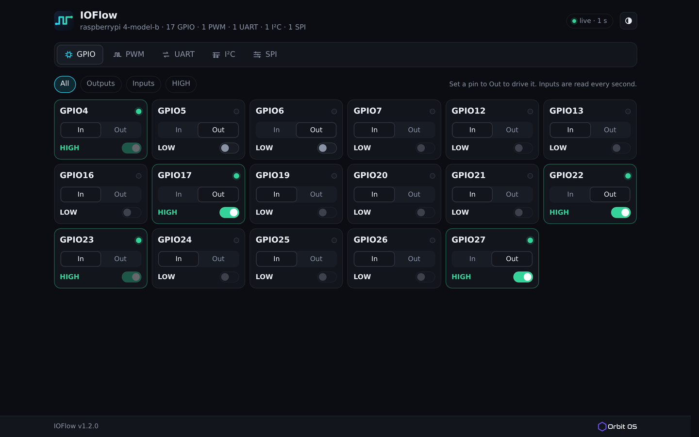

<p align="center">
  
</p>

<h1 align="center">IOFlow for Orbit OS</h1>

<p align="center"><b>GPIO, PWM, UART, I2C and SPI in one place — from your browser, on the device.</b></p>

An [Orbit OS](https://www.orbit-os.org/?ref=github-ioflow) app that brings the five peripheral families
together in a single page. Instead of switching between tools or command-line steps, you pick a peripheral,
set it up and see what the hardware is doing — bringing up a board, checking wiring, or testing a sensor or
an actuator.

It is also an example of a complete Orbit OS app in Go: it reaches every peripheral through the Orbit OS API
with the [Orbit OS Go SDK](https://github.com/OrbitOS-org/orbit-os-sdk-go), embeds its whole web interface in
the binary, and serves its page through the Launcher.

Runs on Raspberry Pi, Arduino UNO Q and other ARM64 devices with Orbit OS (free Community Edition).

<p align="center">
  
</p>

## Features

- **GPIO** — list the pins with their names and state, change direction, read and set levels
- **PWM** — list the channels the device offers, set frequency and duty cycle, turn a channel on and off
- **UART** — pick a port, set it up, send data and watch what arrives, live
- **I2C** — set the bus up, scan for addresses, then read and write a device's registers
- **SPI** — set mode, speed and bits, and run transfers with what was sent and received side by side
- **One workflow** — all five families as tabs on the same page; dark by default, with a light theme
- **Nothing to install on your computer** — the page is served by the device itself
- **No internet needed** — the whole interface, icons included, travels with the app (about 40 KB)

## Install

**From the Orbit OS Store (recommended):** install [IOFlow](https://store.orbit-os.org/app/ioflow?ref=github-ioflow)
on your device in one click.

<a href="https://store.orbit-os.org/app/ioflow?ref=github-ioflow"></a>

**From source — recommended: [Orbit Studio](https://marketplace.visualstudio.com/items?itemName=orbit-os.orbit-studio) (VS Code):**

You need [VS Code](https://code.visualstudio.com/) with the Orbit Studio extension and
**[Go](https://go.dev/dl/) 1.25 or newer** installed.

1. Clone the repository and open the folder in VS Code with the Orbit Studio extension:
   ```bash
   git clone https://github.com/OrbitOS-org/orbit-os-app-ioflow
   code orbit-os-app-ioflow
   ```
2. In the Orbit sidebar, run **Add / Update SDK** and set your device's IP.
3. Use **Run** to try it live against a device in Developer Mode, then **Build + Deploy** to install the
   signed `.orb`.

**Without Orbit Studio:** with the SDK in `orbit-os-sdk-go/` and the development certificates in
`cmd/certs/grpc/`, `go run ./cmd/IOFlow -host <DEVICE_IP>` runs IOFlow on your computer against a device in
Developer Mode — use Orbit Studio to package and sign the `.orb`.

## Getting started

1. Open the device portal at `http://<DEVICE_IP>`, sign in, and open **IOFlow** from the Launcher.
2. The page opens on **GPIO**, with every pin the device exposes. Switch a pin to output and set its level
   to check your wiring.
3. Move to **PWM**, **UART**, **I2C** or **SPI** in the tabs to work with the other peripherals: scan an I2C
   bus for addresses, or open a serial port and watch the bytes arrive.

## Development (Orbit Studio)

This project follows the [Orbit Studio](https://marketplace.visualstudio.com/items?itemName=orbit-os.orbit-studio)
layout for Go apps:

| Path | What |
|---|---|
| `cmd/IOFlow/` | app source — `main.go` (start-up, Launcher registration), `metadata.json` (manifest & permissions) |
| `cmd/IOFlow/templates/`, `cmd/IOFlow/static/` | the page: HTML, CSS and JavaScript, embedded in the binary |
| `cmd/IOFlow/orb/icon.svg` | launcher / Store icon |
| `cmd/certs/` | loads the development TLS material (the certificates are not in the repository) |
| `internal/handlers/` | the HTTP API under `/api/gpio/…` and the page handler |
| `internal/settingsclient/`, `internal/settingsdial/` | opening the connection to the platform |
| `orbit.project.json`, `go.work` | Orbit Studio project settings |

- **Recommended workflow:** open the folder in VS Code with Orbit Studio, **Add / Update SDK** (downloads the
  SDK into `orbit-os-sdk-go/`, which is not in the repository), then **Run** to develop against a device in
  Developer Mode, or **Build + Deploy** to install the `.orb`.
- Development TLS certificates live in `cmd/certs/grpc/` and are never committed. Orbit Studio writes them
  there when you add a device.
- On the device the app reaches the platform through the local socket; `-host` and the certificates are only
  used when you run it on your computer.
- Flags: `-port` (preferred web port, default 50090), `-host`, `-grpc-port`, `-certs`.
- Tests: `go test ./...` (they need no device).

## Security

- The page listens on `127.0.0.1` only and is reached through the Orbit OS Launcher, at
  `http://<DEVICE_IP>/ioflow`, behind the device login. It is not reachable directly from the network.
- The app takes a port in the reserved range 50000–60000 (starting at 50090) and moves to the next one when a
  port is taken or the Launcher refuses it. It opens no other port.
- IOFlow stores nothing: what you see is read from the device when you ask for it. It needs no account.
- Permissions used: `SystemService`, `AppHubService`, `GpioService`, `I2CService`, `PwmService`,
  `SpiService`, `UartService`.
- Driving pins changes the state of real hardware. On a board you care about, check what is wired to a pin
  before you set it.

## Links

[App in the Store](https://store.orbit-os.org/app/ioflow?ref=github-ioflow) ·
[Orbit OS](https://www.orbit-os.org/?ref=github-ioflow) ·
[Getting started](https://www.orbit-os.org/getting_started.html?ref=github-ioflow) ·
[SDK reference](https://www.orbit-os.org/api-reference.html?ref=github-ioflow) ·
[Forum](https://forum.orbit-os.org/?ref=github-ioflow) · info@orbit-os.org

## License

Apache-2.0 — see [LICENSE](LICENSE) and [NOTICE](NOTICE).
